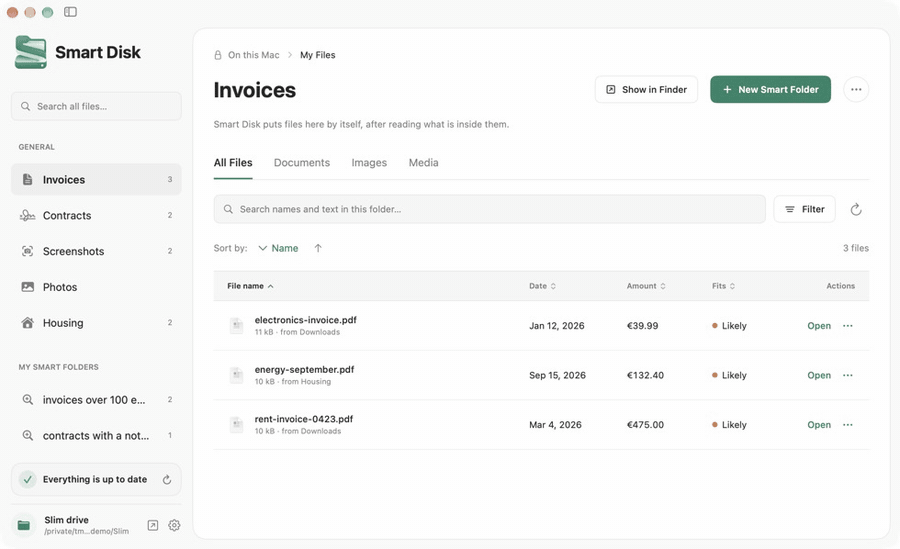
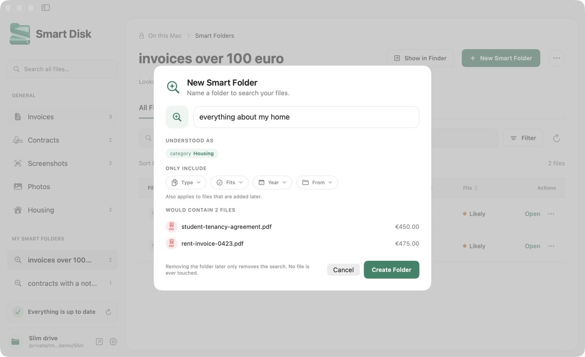
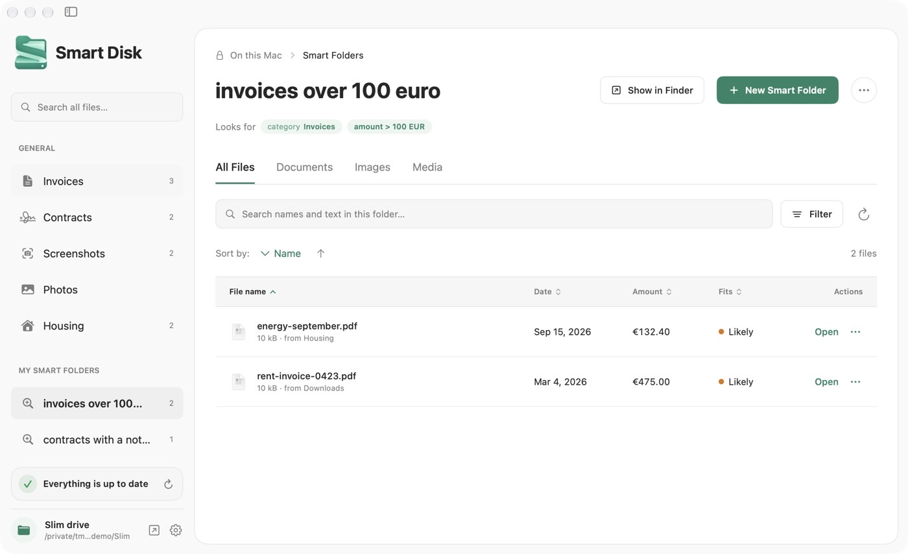

<p align="center">
  
</p>

<h1 align="center">Smart Disk</h1>

<p align="center">
  <strong>Folders that fill themselves. Your original files stay where they are.</strong>
</p>

<p align="center">
  <a href="https://github.com/JitseLambrichts/SmartDisk/actions/workflows/checks.yml"></a>
  
  
  <a href="LICENSE"></a>
</p>

<p align="center">
  <a href="https://github.com/JitseLambrichts/SmartDisk/releases/latest"><strong>Download</strong></a> ·
  <a href="docs/INSTALL.txt">Install guide</a> ·
  <a href="PRIVACY.md">Privacy</a>
</p>

<p align="center">
  
</p>

Smart Disk is a local macOS app that reads the folders you choose and shows
matching files in smart folders. Create a folder called `invoices 2026 over
100 euro` and it fills itself. No account, telemetry or cloud service is used.

## How it works

<table>
  <tr>
    <td width="50%" valign="top">
      
      <p><strong>1. Name a folder.</strong> Write what you are looking for in
      plain words. Smart Disk shows how it understood the name and which files
      would land in it before you create anything.</p>
    </td>
    <td width="50%" valign="top">
      
      <p><strong>2. It fills itself.</strong> Matching files appear with their
      date and amount, and new files join automatically. The folder also shows
      up in Finder, while the originals stay where they are.</p>
    </td>
  </tr>
</table>

- **Reads what is inside.** PDF text, OCR on images and scans, dates and amounts.
- **Built-in categories.** Invoices, contracts, screenshots, photos and housing.
- **Private by design.** Everything runs on your Mac; nothing is uploaded.

<sub>The demo and screenshots use the sample documents from `scripts/make-fixtures.swift`.</sub>

## Download and install

Download **SmartDisk-0.3.0-macOS-universal.zip** from
[Releases](https://github.com/JitseLambrichts/SmartDisk/releases/latest).
It contains the app and an English quick-start guide. The universal app runs
on **Apple silicon and Intel Macs with macOS 26 or later**. Recipients do not
need Rust, Xcode, Homebrew or a FUSE driver. Apple Intelligence is optional.

1. Unpack the ZIP and drag **SmartDisk.app** to **Applications**.
2. Open Smart Disk. This community build is not notarized: if macOS blocks
   the first launch, follow **READ ME FIRST.txt** inside the ZIP.
3. Select **Choose Folders…** and allow access when macOS asks.
4. Create a smart folder. For Finder and Open dialogs, drag `~/Slim` into
   Finder's sidebar. Keep the menu bar app running to update the drive.

Do not disable Gatekeeper. See [Apple's opening instructions](https://support.apple.com/en-us/102445)
and the [installation guide](docs/INSTALL.txt).

## Your files and privacy

- Source folders are opt-in. OCR, indexing and search run on your Mac.
- The drive contains links to originals. A file can appear in several folders.
  Opening and editing a file through the drive edits that original.
- Removing a smart folder removes the search. Removing a file from a smart
  folder excludes it there. It does not delete the original.
- A new file saved onto the mirror drive goes to `~/Documents/Slim Inbox`.
- Recognised identity documents stay hidden across the drive and search until
  you enable them under Settings → Privacy. Classification is imperfect;
  choose sources carefully before giving another app access to the drive.
- The private index is stored in `~/Library/Application Support/SmartDisk`.
  It contains extracted facts and, by default, document text. Turning off
  document text storage also clears previously stored text from active records.
  The index is not separately encrypted. Backups may retain previous data.
- Removing a source folder revokes its results and removes its indexed records.
  An original inside another selected source or the Inbox remains in scope.

See [PRIVACY.md](PRIVACY.md) and [SECURITY.md](SECURITY.md).

## Build and share a ZIP

For developers: install Rust (including rustup), Xcode with the macOS 26 SDK
or newer, and its command-line tools. Swift 6.2 or newer is required.

```sh
rustup target add aarch64-apple-darwin x86_64-apple-darwin
scripts/package-release.sh --universal
```

The shareable ZIP and SHA-256 checksum appear in `dist/`. Only the app,
license and English instructions enter the archive. Personal indexes,
configuration, source code and developer credentials are excluded by construction.
The command validates signatures, bundled components, library dependencies and
a clean first-run index before packaging.

For a quicker build for your own Mac:

```sh
scripts/build-app.sh
open dist/SmartDisk.app
```

Ad-hoc signing allows local testing; downloaded copies may be blocked at first
launch. Optional Developer ID signing and notarization are documented in
[RELEASING.md](docs/RELEASING.md). No signing secrets are stored in this repo.

## Development checks

```sh
cargo test --workspace --locked
swift test --package-path macos
scripts/check-secrets.sh
```

CI runs Rust tests, a full-history secret scan and a universal macOS package
build. Its ZIP artifact can be shared with testers. The manual release workflow
creates a draft GitHub release with a downloadable ZIP; configure a GitHub
remote before using it. Public hosting is separate from creating a local ZIP.

## Command line

The CLI is bundled inside `SmartDisk.app/Contents/MacOS/slim`. Add that location
to your shell's PATH or use its full path. Every command accepts `--json`.

```sh
slim status
slim folders add ~/Downloads
slim index
slim tree
slim query "contracts with a notice period"
slim mkdir "invoices 2026 over 100 euro"
slim grep "invoice number" --folder Invoices
slim why ~/Slim/Invoices/invoice.pdf
slim settings set sensitive true
```

The hidden `.slim` directory on the drive contains status and explanation files
for scripts. A process lock prevents duplicate daemons from using one index.

Folder names can be English or Dutch; the interface and help are English.
Built-in categories: Invoices, Contracts, ID Documents, Screenshots, Photos
and Housing. Large scans pause on battery by default.

## Architecture

| Path | Role |
| --- | --- |
| `crates/core` | SQLite index, extraction, facts, categories, search and smart folders |
| `crates/fs` | Mirror drive of symbolic links; optional FUSE backend |
| `crates/cli` | Bundled CLI, watcher and background indexing |
| `macos/Sources/SlimHelper` | PDFKit, Vision OCR and optional Foundation Models |
| `macos/Sources/SmartDisk` | SwiftUI app, settings and menu bar |

The mirror backend requires no extra installation. A real FUSE drive is an
experimental developer option (`scripts/build-app.sh --fuse`) requiring
FUSE-T or macFUSE; its libraries are not bundled in the standard download.
FSKit integration is planned and is not included.

Dates and amounts are parsed by rules. The built-in `hash-512-v1` embedder
needs no model download; it compares words and trigrams, with a small concept
list, rather than using a neural semantic model. Apple Intelligence may help
interpret folder categories when available, while numeric filters remain
rule-based.

## Sample documents

```sh
swift scripts/make-fixtures.swift /tmp/smartdisk-demo
export SLIM_HOME=/tmp/smartdisk-demo/.index
slim folders add /tmp/smartdisk-demo/Downloads
slim index
```

Use `SLIM_HOME` for isolated experiments so tests never use your personal index.

## License

[MIT](LICENSE)
